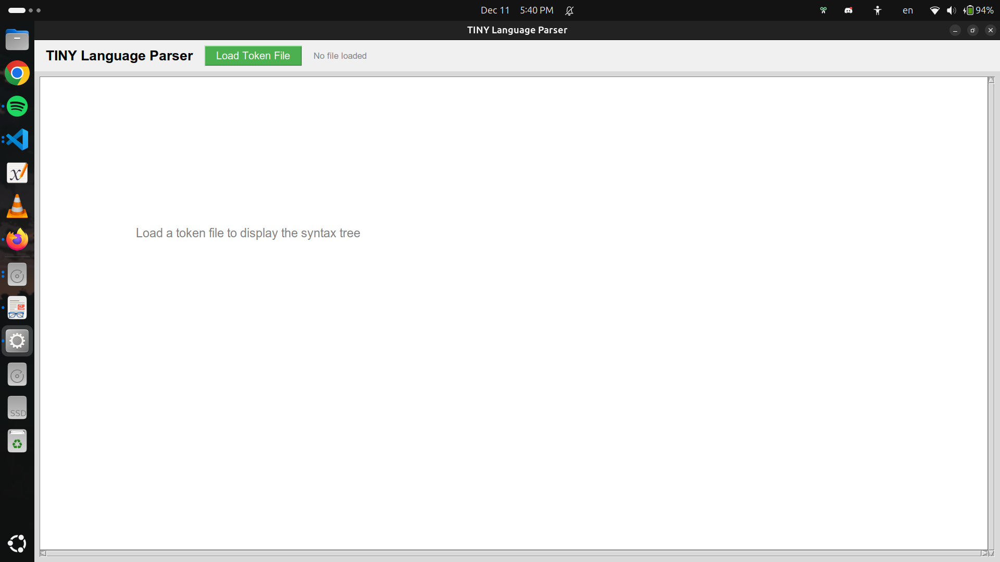
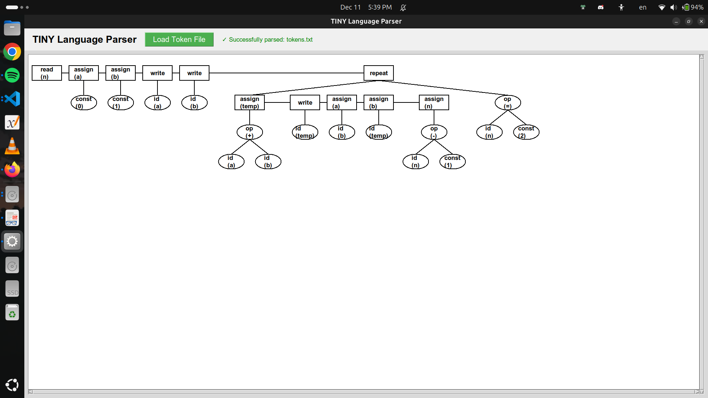
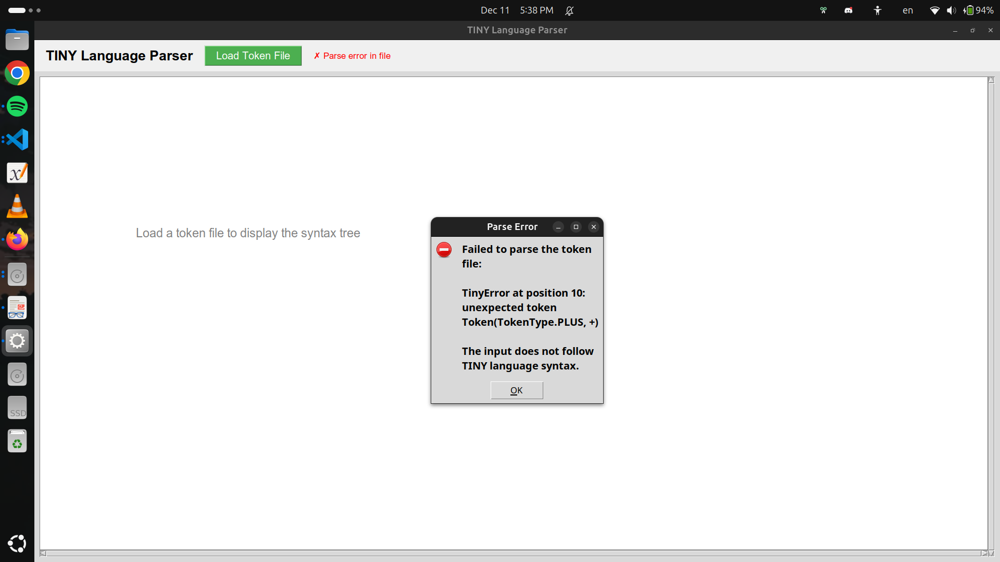

# TINY Language Compiler Report

---

## Team Members

- **[Your Name]** - ID: [Your ID]
- **[Team Member 2]** - ID: [ID]
- **[Team Member 3]** - ID: [ID]

---

## 1. Scanner (Lexical Analyzer)

### Overview

[SPACE FOR SCANNER EXPLANATION - Add your scanner details here]

### Key Features

- [Feature 1]
- [Feature 2]
- [Feature 3]

### Implementation Details

[Add scanner implementation details, token types, regex patterns, etc.]

---

## 2. Parser (Syntax Analyzer)

### Overview

The parser is a **recursive descent parser** that implements the TINY language grammar. It reads tokens from the scanner output and builds an Abstract Syntax Tree (AST) representing the program structure.

### Grammar Rules Implemented

The parser follows these TINY language grammar rules:

```
program → stmt-sequence
stmt-sequence → statement { ; statement }
statement → if-stmt | repeat-stmt | assign-stmt | read-stmt | write-stmt
if-stmt → if exp then stmt-sequence [else stmt-sequence] end
repeat-stmt → repeat stmt-sequence until exp
assign-stmt → identifier := exp
read-stmt → read identifier
write-stmt → write exp
exp → simple-exp [comparison-op simple-exp]
comparison-op → < | =
simple-exp → term { addop term }
addop → + | -
term → factor { mulop factor }
mulop → * | /
factor → (exp) | number | identifier
```

### Key Components

#### 2.1 Parser Class (`src/parse/parser.py`)

The main parser class implements recursive descent parsing with methods for each grammar rule:

- **`parse_program()`** - Entry point for parsing
- **`parse_statement_sequence()`** - Handles statement sequences with semicolons
- **`parse_statement()`** - Dispatches to specific statement parsers
- **`parse_if_statement()`** - Parses if-then-else structures
- **`parse_repeat_statement()`** - Parses repeat-until loops
- **`parse_assign_statement()`** - Parses variable assignments
- **`parse_read_statement()`** - Parses read operations
- **`parse_write_statement()`** - Parses write operations
- **`parse_expression()`** - Handles expressions with comparison operators
- **`parse_simple_expression()`** - Handles addition/subtraction
- **`parse_term()`** - Handles multiplication/division
- **`parse_factor()`** - Handles identifiers, numbers, and parenthesized expressions

#### 2.2 Syntax Tree (`src/parse/syntax_tree.py`)

Defines the AST node types:

- **Statement Nodes**: IfStatement, RepeatStatement, AssignStatement, ReadStatement, WriteStatement
- **Expression Nodes**: ComparisonExpression, BinaryOpExpression, IdentifierExpression, NumberExpression
- **StatementSequence**: Represents a sequence of statements

#### 2.3 Token Stream (`src/parse/token_stream.py`)

Provides token management with:
- **`peek()`** - Look at current token without consuming
- **`consume()`** - Move to next token
- **`position`** - Track current position for error reporting

### Features

- ✓ **EBNF Conversion**: Left-recursive grammar rules converted to EBNF for recursive descent
- ✓ **Error Handling**: Syntax errors detected with position information
- ✓ **AST Generation**: Complete abstract syntax tree for valid programs
- ✓ **Operator Precedence**: Correct handling of expression precedence

---

## 3. GUI Visualization

### Overview

The project includes a graphical user interface for visualizing the Abstract Syntax Tree.

### Components

- **Main Window** (`src/gui/main_window.py`) - Application window with file loading
- **Tree Visualizer** (`src/gui/tree_visualizer.py`) - Canvas-based tree rendering

### Features

- Load token files via file dialog
- Visual AST representation with:
  - **Rectangles** for statement nodes
  - **Ovals** for expression nodes
  - **Lines** connecting parent-child relationships
- Clear syntax error messages

---

## 4. Execution & Results

### How to Run

1. **Start the GUI:**
   ```bash
   python main.py
   ```

2. **Load a token file:**
   - Click "Load Token File"
   - Select a file (e.g., `input_sample.txt`, test cases)

3. **View the syntax tree:**
   - Tree displays automatically if parsing succeeds
   - Error message shown if syntax errors detected

## 5. Screenshots

### Screenshot 1: Main Application Window


### Screenshot 2: Syntax Tree Visualization



### Screenshot 3: Error Handling


---

## 6. Project Structure

```
code/
├── main.py                    # Application entry point
├── src/
│   ├── parse/
│   │   ├── parser.py         # Recursive descent parser
│   │   ├── syntax_tree.py    # AST node definitions
│   │   ├── token_stream.py   # Token stream manager
│   │   └── token_file_parser.py  # Token file reader
│   ├── gui/
│   │   ├── main_window.py    # Main GUI window
│   │   └── tree_visualizer.py # AST visualization
│   └── tinyerror/
│       └── tiny_error.py     # Error handling
└── test_case_*/               # Test cases
```

---
